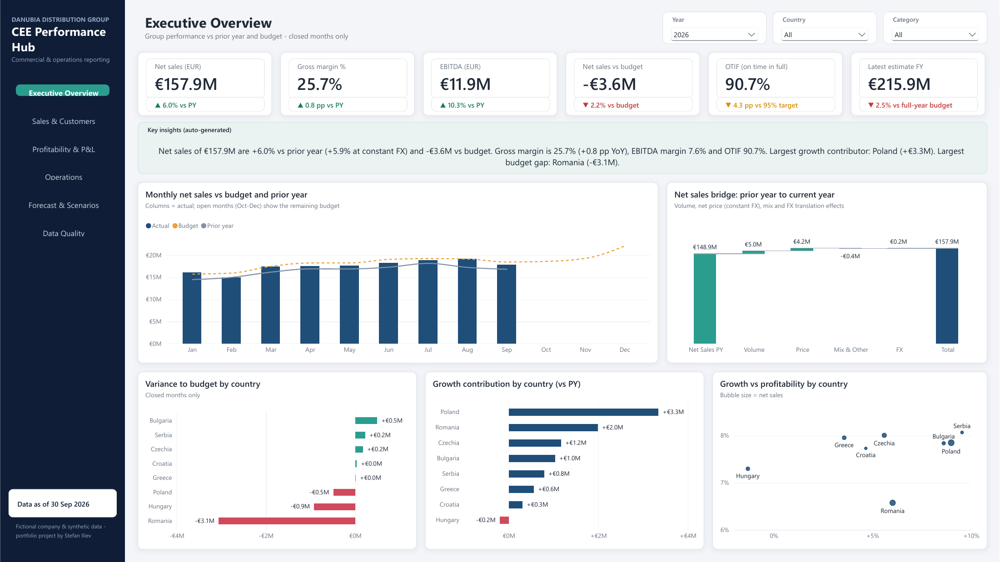
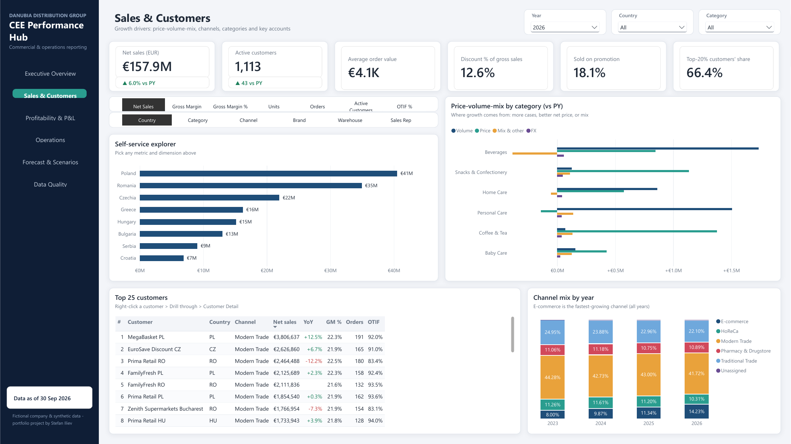
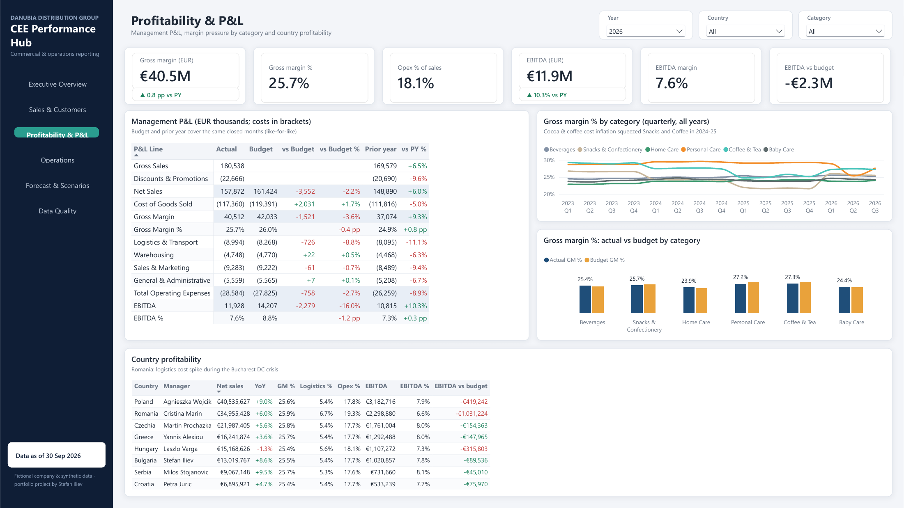
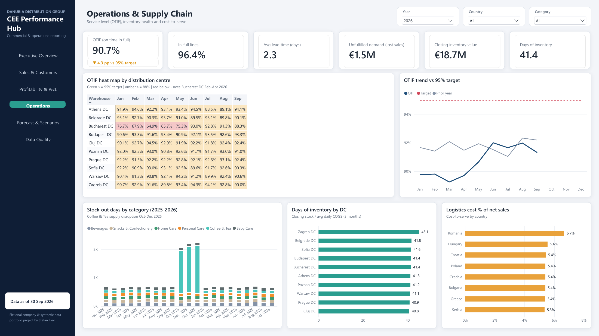
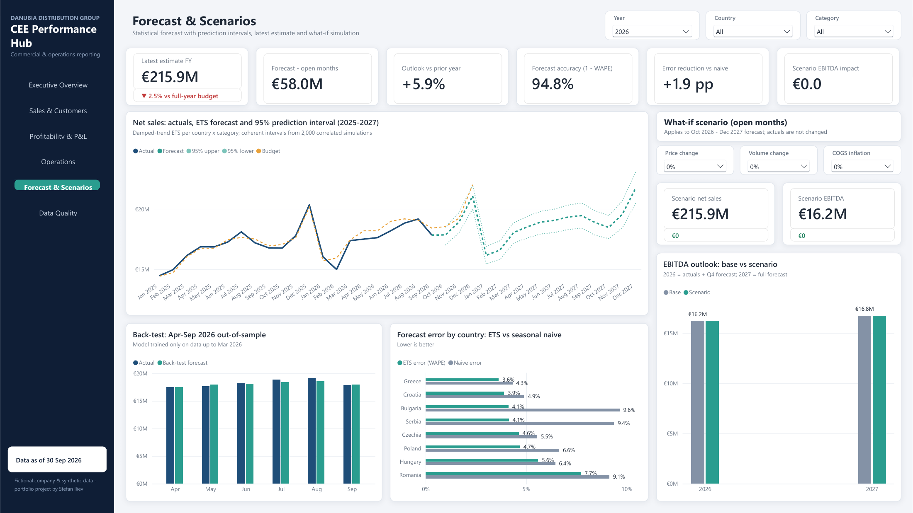
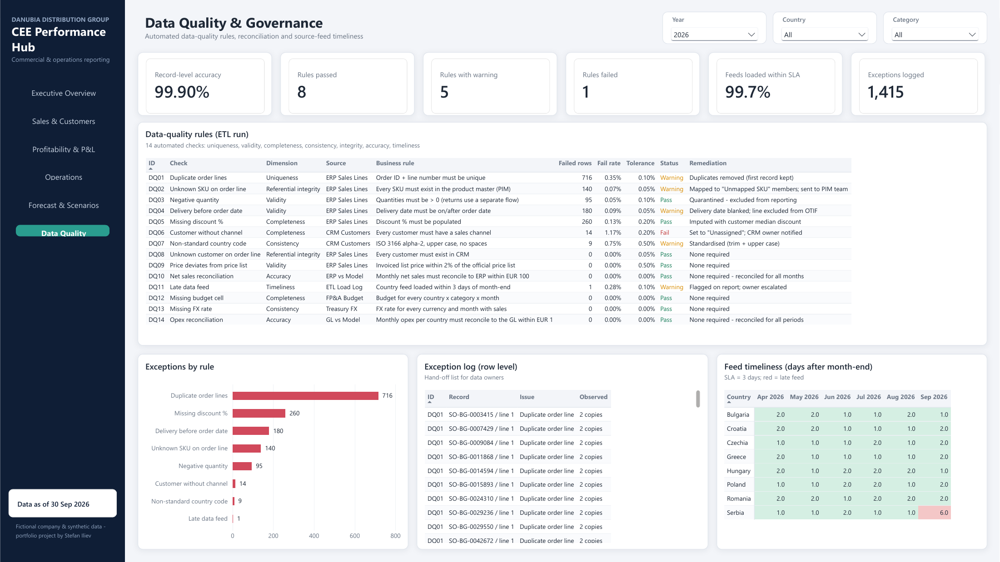

# CEE Commercial & Operations Performance Hub

**End-to-end Power BI project:** raw source extracts → SQL ETL with automated data-quality rules → governed star-schema semantic model (160 DAX measures, RLS, calculation group) → statistical forecast with prediction intervals → 8-page executive report.


*Danubia Distribution Group* is a **fictional** B2B FMCG distributor operating in 8 Central & Eastern European countries (Poland, Romania, Czechia, Hungary, Greece, Bulgaria, Serbia, Croatia). The project answers the questions a CFO, a commercial director and a supply-chain head would ask in a monthly business review, and shows how the numbers are produced, checked and governed.



> All data is synthetic and generated by `etl/01_generate_source_data.py`. The company, customers and people are fictional. Data as of 30 Sep 2026.

---

## Contents
- [Headline results](#headline-results)
- [Report pages](#report-pages)
- [Architecture](#architecture)
- [Data quality & governance](#data-quality--governance)
- [Semantic model](#semantic-model)
- [DAX highlights](#dax-highlights)
- [Forecasting](#forecasting)
- [Repository structure](#repository-structure)
- [How to run](#how-to-run)
- [Key modelling decisions](#key-modelling-decisions)

---

## Headline results
YTD Jan–Sep 2026, all closed months, compared like-for-like.

| KPI | Value | Comparison |
|---|---|---|
| Net sales | **€157.9M** | +6.0% vs PY (+5.9% at constant FX) · −€3.6M (−2.2%) vs budget |
| Gross margin | **25.7%** | +0.8 pp vs PY |
| EBITDA | **€11.9M** (7.6% margin) | +10.3% vs PY · −€2.3M vs budget |
| OTIF | **90.7%** | −4.3 pp vs 95% target |
| Full-year latest estimate | **€215.9M** | −2.5% vs full-year budget |
| Forecast accuracy (1 − WAPE) | **94.8%** | ETS WAPE 5.2% vs 7.1% for seasonal naive |
| Record-level data accuracy | **99.90%** | 14 rules: 8 pass · 5 warning · 1 fail |

### The business stories the report surfaces
1. **Growth, but behind plan.** Net sales grow +6.0%, yet the group is 2.2% below budget. Poland (+€3.3M) and Romania (+€2.0M) contribute most of the growth.
2. **Romania's Bucharest DC crisis.** A capacity problem pushed the DC's OTIF down to 65–68% in Feb–Apr 2026. Logistics cost rose to 6.7% of sales (vs ~5.4% elsewhere) and Romania is €3.1M (−8%) below budget, the largest gap in the group.
3. **FX translation in Hungary.** Sales grow in HUF but fall 1.3% in EUR. Constant-currency KPIs separate real performance from translation effects.
4. **Margin squeeze and recovery.** Cocoa and coffee cost inflation hit Snacks and Coffee & Tea margins in 2024–25. Margins recover in 2026.
5. **Supply disruption.** A Coffee & Tea supply problem in Oct–Dec 2025 shows up as a spike in stock-out days and short shipments.
6. **Channel and customer concentration.** E-commerce is the fastest-growing channel (8.0% → 14.2% of sales between 2023 and 2026). The top 20% of customers generate ~66% of net sales.
7. **Data issues are visible, not hidden.** One rule fails (customers without a sales channel) and the Serbian September feed arrived 6 days after month-end, against a 3-day SLA.

---

## Report pages

| Page | Purpose |
|---|---|
| **Executive Overview** | KPI cards vs PY / budget / target, an auto-generated narrative, monthly actual vs budget vs PY, a PY→CY sales bridge, country variance and growth contribution |
| **Sales & Customers** | Self-service explorer with 7 metrics × 6 dimensions (field parameters), price-volume-mix by category, top-25 customers, channel mix |
| **Profitability & P&L** | Management P&L (actual, budget, PY, variances), margin trends by category, country profitability with the manager responsible |
| **Operations & Supply Chain** | OTIF heat map by DC, OTIF vs target, stock-out days, days of inventory, cost-to-serve |
| **Forecast & Scenarios** | ETS forecast with a 95% prediction interval, back-test vs actuals, error vs naive by country, what-if price / volume / COGS scenario |
| **Data Quality & Governance** | 14 DQ rules with tolerance and status, row-level exception log, feed-timeliness matrix |
| **Customer Detail** *(drill-through)* | Right-click any customer → KPIs, monthly trend, category mix, products bought |
| **Country Tooltip** *(report-page tooltip)* | Mini country scorecard shown on hover |

Navigation runs through a side menu with page buttons. Year, country and category slicers are synced across pages.

<details>
<summary><b>Screenshots of all pages</b> (click to expand)</summary>

#### Sales & Customers


#### Profitability & P&L


#### Operations & Supply Chain


#### Forecast & Scenarios


#### Data Quality & Governance


</details>

---

## Architecture

```mermaid
flowchart LR
    subgraph SRC["Source systems (CSV extracts)"]
        ERP["ERP<br/>sales lines, price list"]
        CRM["CRM<br/>customers"]
        WMS["WMS<br/>inventory, warehouses"]
        GL["GL<br/>opex"]
        FPA["FP&A<br/>budget"]
        TRS["Treasury<br/>FX rates"]
    end
    subgraph ETL["SQL ETL (DuckDB)"]
        STG["01 staging<br/>typing, dedup"]
        DQ["02 data-quality rules<br/>14 checks + exception log"]
        STAR["03 star schema<br/>dims + facts, EUR conversion"]
        REC["04 reconciliation<br/>to ERP and GL"]
    end
    FC["Python forecast<br/>ETS + bootstrap intervals"]
    PQ[("Parquet<br/>star schema")]
    SM["Power BI semantic model<br/>TMDL, 160 measures, RLS"]
    RPT["Power BI report<br/>8 pages, PBIR"]

    SRC --> STG --> DQ --> STAR --> REC --> PQ
    PQ --> FC --> PQ
    PQ -->|"Power Query<br/>DataFolder parameter"| SM --> RPT
```



| Layer | Implementation |
|---|---|
| Source data | Python generator for 6 source systems (ERP, CRM, WMS, GL, FP&A, Treasury) with ~205K sales lines from Jan 2023 to Sep 2026 and deliberately injected defects (`data/raw/_injected_defects_reference.csv`) |
| ETL | 4 SQL scripts run in DuckDB by `etl/02_run_etl.py`. The output is a Parquet star schema |
| Forecast | `forecast/03_forecast.py` (statsmodels ETS) writes the forecast, interval and accuracy tables |
| Semantic model | Power BI Project (PBIP) with the model in TMDL, so every table, measure and role is a readable, diff-able text file |
| Report | PBIR (enhanced report format), custom theme, 236 visuals on 8 pages |

---

## Data quality & governance

The ETL runs **14 rule-based checks** before data reaches the model. Each rule has a dimension, a tolerance, a status and a documented remediation. Every failing record goes to a row-level exception log that data owners can act on.

| Dimension | Rules |
|---|---|
| Uniqueness | DQ01 duplicate order lines |
| Referential integrity | DQ02 unknown SKU · DQ08 unknown customer |
| Validity | DQ03 negative quantity · DQ04 delivery before order date · DQ09 price deviates from list price |
| Completeness | DQ05 missing discount · DQ06 customer without channel · DQ12 missing budget cell |
| Consistency | DQ07 non-standard country code · DQ13 missing FX rate |
| Accuracy (reconciliation) | DQ10 net sales reconcile to ERP within €100 per month · DQ14 opex reconciles to GL |
| Timeliness | DQ11 country feed loaded within 3 days of month-end |

Remediation is explicit. Duplicates are removed (first record kept). Unknown SKUs are mapped to an "Unmapped SKU" member. Delivery dates before the order date are blanked and the line is excluded from OTIF. Customers without a channel are set to "Unassigned" and the CRM owner is notified.

**Governance features in the model:**
- **Dynamic row-level security.** In the *Country Manager* role, `USERPRINCIPALNAME()` is matched to the manager's email, so each manager sees only their own country. *Group Management* sees everything.
- **One parameter for portability.** The `DataFolder` Power Query parameter points all queries to the Parquet folder.
- **Documented measures.** All 160 measures have descriptions and sit in 11 display folders.
- **Source control.** PBIP, TMDL and PBIR are text formats that work with Git and code review.

---

## Semantic model

A star schema with 24 single-direction relationships and a separate `_Measures` table.

| Group | Tables |
|---|---|
| **Facts** | `Sales` (order-line grain, 204K rows) · `Budget` (month × country × category) · `Opex` (month × country × P&L line) · `Inventory` (monthly snapshot by DC × SKU) · `FX Rates` |
| **Dimensions** | `Date` · `Country` · `Category` · `Product` · `Customer` · `Warehouse` · `P&L Line` |
| **Forecast** | `Forecast` · `Forecast Interval` · `Forecast Accuracy` |
| **Data quality** | `DQ Checks` · `DQ Exceptions` · `DQ Load Log` |
| **Report helpers** | `Time Intelligence` (calculation group, 8 items) · `Metric Selector` and `Breakdown Selector` (field parameters) · 3 what-if parameters (price, volume, COGS inflation) · `Bridge Step` |

**Measure display folders:** 01 Sales · 02 Profitability · 03 Budget · 04 Time Intelligence · 05 FX & Price-Volume-Mix · 06 Operations · 07 Forecast · 08 Scenario · 09 Data Quality · 10 Report UI · 11 P&L

---

## DAX highlights

**Like-for-like prior year.** The comparison uses only months that are closed in the current year, so Jan–Sep is never compared with a full prior year:
```dax
Net Sales PY =
CALCULATE (
    [Net Sales],
    CALCULATETABLE ( SAMEPERIODLASTYEAR ( 'Date'[Date] ), 'Date'[Is Actual Period] = TRUE () )
)
```

**Budget grain guard.** The budget exists at month × country × category level. Below that grain the measure returns blank instead of repeating misleading values:
```dax
Budget Net Sales =
IF (
    NOT ( ISFILTERED ( 'Product' ) || ISCROSSFILTERED ( Customer ) || ISCROSSFILTERED ( Warehouse ) ),
    SUM ( Budget[Budget Net Sales EUR] )
)
```

**Semi-additive inventory.** Stock is a balance, so it takes the last snapshot in the selected period instead of summing months:
```dax
Inventory Value =
VAR _lastSnapshot = CALCULATE ( MAX ( Inventory[Snapshot Date] ), ALL ( Inventory ), VALUES ( 'Date'[Date] ) )
RETURN CALCULATE ( SUM ( Inventory[On Hand Value EUR] ), 'Date'[Date] = _lastSnapshot )
```

**Calculation group.** Time intelligence is defined once and applied to any measure: Current, PY, YoY, YoY %, YTD, PY YTD, YTD YoY %, Rolling 12M.

**Other techniques used:**
- A price-volume-mix bridge with an FX translation effect, and constant-currency growth (current year re-translated at prior-year rates)
- A P&L engine: one `SWITCH` measure drives the whole management P&L from the `P&L Line` dimension, with subtotals, ratios and sign conventions
- Top-20% customer share (Pareto) and customer ranking with `RANKX` over `ALLSELECTED`
- What-if scenarios applied only to open (forecast) months
- An auto-generated executive narrative built in DAX
- Conditional-formatting measures for status colours and KPI arrows

---

## Forecasting

| Step | Method |
|---|---|
| Model | ETS (exponential smoothing) per country × category (48 series), with an additive damped trend and additive 12-month seasonality. It is fitted on log(net sales), so intervals are asymmetric and always positive |
| Validation | 6-month out-of-sample back-test: train on Jan 2023–Mar 2026, predict Apr–Sep 2026, benchmark against seasonal naive |
| Accuracy | **WAPE 5.2% vs 7.1%** for seasonal naive (a 27% error reduction). ETS beats naive in every country |
| Intervals | 2,000 simulated paths per series using a residual bootstrap with a **shared random index**, so shocks stay correlated across series. Intervals can then be aggregated correctly to country, category and group level (summing bounds or assuming independence would be wrong) |
| Output | Forward forecast for Oct 2026–Dec 2027. It feeds the full-year latest estimate (actuals + forecast) and the what-if scenario |

---

## Repository structure
```
├── CEE Performance Hub.pbip            ← open this in Power BI Desktop
├── CEE Performance Hub.SemanticModel/  semantic model (TMDL): tables, measures, relationships, roles
├── CEE Performance Hub.Report/         report (PBIR): 8 pages, visuals, custom theme
├── data/
│   ├── raw/                            source-system extracts (CSV)
│   └── model/                          star schema (Parquet) loaded by Power BI
├── etl/
│   ├── 01_generate_source_data.py      synthetic source systems with injected defects
│   └── 02_run_etl.py                   runs the SQL pipeline and exports Parquet
├── sql/
│   ├── 01_staging.sql                  typing, cleansing, deterministic de-duplication
│   ├── 02_data_quality_checks.sql      14 DQ rules + row-level exception log
│   ├── 03_transform_star_schema.sql    dimensions, facts, EUR conversion
│   └── 04_reconciliation.sql           model vs ERP / GL reconciliation
├── forecast/03_forecast.py             ETS forecast, back-test, bootstrap intervals
├── model_build/                        measure catalogue and table definitions used to build the model
├── report_build/                       Python PBIR report generator + JSON-schema validator
└── images/                             report screenshots
```

---

## How to run

**Option A: just explore the report**
1. Clone the repo to `C:\PowerBI\CEE-Performance-Hub`, or anywhere else (see step 3).
2. Open `CEE Performance Hub.pbip` in a recent version of Power BI Desktop that supports PBIP.
3. If you cloned to a different folder, go to **Transform data → Edit parameters → `DataFolder`** and set it to `<your folder>\data\model\`.
4. Click **Refresh**. The data cache is not committed to Git, so the first open needs one refresh.

**Option B: rebuild everything from scratch**
```bash
pip install duckdb pandas numpy statsmodels
python etl/01_generate_source_data.py   # source extracts -> data/raw
python etl/02_run_etl.py                # staging, DQ, star schema, reconciliation -> data/model
python forecast/03_forecast.py          # forecast tables -> data/model
```
Then open the `.pbip` and refresh.

**Test row-level security:** go to Modeling → **View as**, tick *Country Manager* and set *Other user* to `manager.ro@danubia-demo.com`. Every page then shows Romania only.

---

## Key modelling decisions
- **Like-for-like comparisons.** Prior-year and budget measures only use months that are closed in the current year (`'Date'[Is Actual Period]`).
- **Respecting the budget grain.** Budget and opex are not allocated below the level at which they are planned. Below that level they return blank.
- **FX.** Amounts are converted at monthly average rates. Constant-currency sales are re-translated at prior-year rates. Bulgarian BGN history is restated to EUR at the irrevocable rate of 1.95583, since Bulgaria adopted the euro on 1 Jan 2026.
- **Static number formats, on purpose.** Dynamic K/M format strings double-scale when visuals use *Auto* display units, so measures keep static formats and the visuals handle the scaling.
- **Coherent forecast intervals.** Intervals are aggregated from correlated simulations, not by summing bounds.
- **Deterministic ETL.** De-duplication uses an explicit `ORDER BY`, so reconciliation results are the same on every run.

---

**Author:** Stefan Iliev · Business / Data Analyst portfolio project
**Tools:** Power BI Desktop (PBIP · TMDL · PBIR), DAX, Power Query, SQL (DuckDB), Python (pandas, statsmodels)
